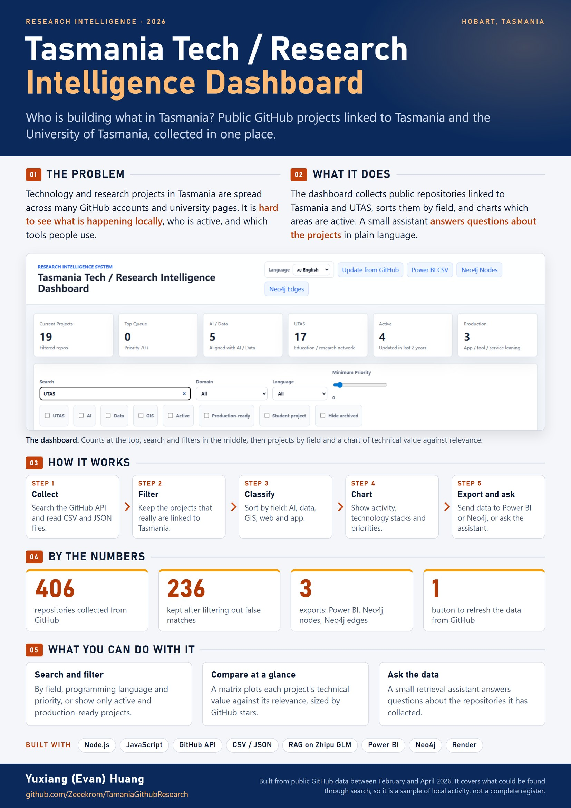
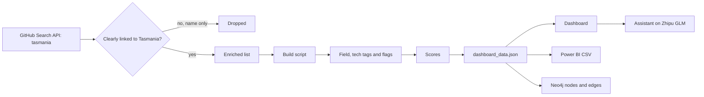
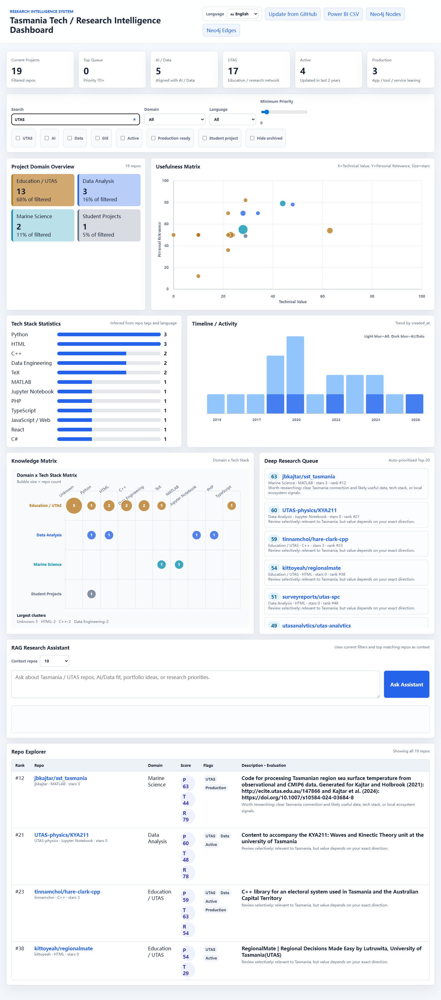

# Tasmania Tech / Research Intelligence Dashboard

**English** · [简体中文](README.zh-CN.md)

The Tasmania Tech / Research Intelligence Dashboard collects public GitHub repositories linked to Tasmania and the University of Tasmania (UTAS) in one place. It sorts them by field, charts which areas are active and which tools people use, and lets you search, filter and export the list. It is for anyone trying to see what is being built locally: students and job seekers, people mapping the local tech and research scene, and analysts who want the data in their own tools.

AI is optional and comes last. A small retrieval assistant on the Zhipu GLM API answers questions about the repositories on screen. It receives only the records the dashboard picks for the question, at most 30, and is told to make claims about a repository only from those records. The key stays on the server, and the dashboard works fully without it.

This is an independent portfolio project built from one GitHub search. It is a sample of public activity, not a complete register of Tasmanian software or research, and it is not an official UTAS or Tasmanian Government resource.

This repository holds the source: the Node.js server, the dashboard page, the build and check scripts, the collected repository lists, and the exports for Power BI and Neo4j.

<table>
<tr>
<td></td>
</tr>
<tr>
<td align="center"><a href="docs/poster.jpg">Poster, October 2026</a></td>
</tr>
</table>

## Contents

- [At a glance](#at-a-glance)
- [The problem](#the-problem)
- [Who it is for](#who-it-is-for)
- [One repository, start to finish](#one-repository-start-to-finish)
- [The screens](#the-screens)
- [What works today](#what-works-today)
- [Design principles](#design-principles)
- [Public data and derived data](#public-data-and-derived-data)
- [How it was built](#how-it-was-built)
- [Problems that became rules](#problems-that-became-rules)
- [Technology stack](#technology-stack)
- [Interfaces](#interfaces)
- [Verification](#verification)
- [Running it](#running-it)
- [What is not finished](#what-is-not-finished)
- [What the project showed](#what-the-project-showed)
- [Copyright and terms](#copyright-and-terms)

## At a glance

| | |
|---|---|
| What it is | A dashboard of public GitHub repositories linked to Tasmania and UTAS, grouped by field, with charts, filters, a research queue, exports and an optional question assistant |
| Who it is for | Students and job seekers looking at local tech and research work, people mapping who builds what in Tasmania, and analysts who want the list in Power BI or Neo4j |
| The problem | Local projects are spread across many accounts and pages. A GitHub search for "tasmania" mixes them with projects that only borrow the name |
| AI | An optional retrieval assistant on the Zhipu GLM API (`glm-4.7` by default). It answers from at most 30 repository records chosen in the browser and needs a key set on the server |
| Stack | Node.js 20+ with built-in modules only, plain HTML, CSS and JavaScript, the GitHub REST API, the Zhipu GLM API, CSV and JSON, Power BI and Neo4j exports, Render |
| Data | 406 results from the GitHub Search API on 14 May 2026; 236 kept as clearly linked to Tasmania; 11 fields. Public metadata only |
| Evidence | One recorded headless-browser check (14 May 2026): 6 summary cards, 236 table rows, 236 matrix points, 11 field tiles, 20 queue cards, 19 rows after searching "UTAS", no console errors |
| Status | Version 0.2.0. A portfolio project, live on Render's free plan. The data has not been refreshed since 14 May 2026 |

## The problem

Anyone trying to understand local tech and research work has to answer questions like these:

- Who in Tasmania is building software, and in which fields?
- Which projects are still active, and which are archived or stale?
- Which languages and tools do local projects use?
- Which projects come from UTAS courses, research groups or institutes?
- Which projects are worth reading first for AI, data or GIS work?
- Can the list be taken into other tools for further analysis?

GitHub answers none of these directly. A search for "tasmania" returned 406 repositories, and many use the word only as a name. The dashboard keeps the 236 that are clearly linked to Tasmania and organises them so these questions can be answered on one page.

## Who it is for

| Role | The question they need answered | What the dashboard shows them |
|---|---|---|
| Student or job seeker | Which local projects match AI, data or GIS work, and which are worth reading first? | Filters by field and flag, a priority score, a top-20 research queue and the assistant |
| Someone mapping the local scene | Who is active, in which fields, with which tools? | Field tiles, a timeline by year created, tech stack counts and a field-by-tech matrix |
| Analyst | Can I work with this data in my own tools? | A Power BI CSV and Neo4j node and edge files |
| Local developer | My project is missing. Can I add it? | A contribution form that checks for a Tasmania or UTAS signal before adding a project or profile |

These are the uses the dashboard was designed for. No user study was done.

## One repository, start to finish

1. **Search.** The GitHub Search API is queried for "tasmania". On 14 May 2026 it returned 406 repositories, saved with name, link, description, language, stars, forks, archived flag, dates and topics.
2. **Filter.** A repository is kept when its name or description clearly points to a Tasmanian place, government body or service, UTAS, Tasmanian species or ecology, a local business or community, history, tourism, mapping, climate, transport, real estate or data. Generic libraries, profiles and demos that only use the word are dropped. 236 are kept.
3. **Enrich.** Each kept repository gets a short Chinese description, one of eight original categories, a short evaluation and a relevance level with a score from 1 to 5 and a reason.
4. **Classify.** `scripts/build_research_dashboard.mjs` places each repository in one of 11 fields with keyword rules checked in a fixed order, from AI / Machine Learning first to Other Tasmania last. The first rule that matches wins. It also infers up to eight tech tags and sets eight flags: UTAS, AI, data, GIS, active, archived, student project and production-leaning.
5. **Score.** Technical value counts stars and forks on a log scale, recent activity, production signals and AI, data or GIS work. Personal relevance starts from the enrichment score and adds weight for the fields the project was looking for. Priority combines the two, weighting relevance slightly more. Activity is measured against a fixed date, 14 May 2026, so a rebuild gives the same scores.
6. **Export.** The script writes `dashboard_data.json`, a 236-row Power BI CSV, and Neo4j node and edge files for the top 140 repositories by priority.
7. **Explore.** The dashboard shows the counts, the field tiles, a matrix of technical value against relevance sized by stars, tech stack bars, a timeline, a field-by-tech matrix, the research queue and a table. Search and filters update every panel.
8. **Ask.** The assistant ranks the filtered repositories by keyword match plus priority and sends the top 5 to 50 (10 by default) to the server. The server passes at most 30 to the model, with an instruction to make repository claims only from those records.

## The screens

The full dashboard, captured by the check script on 14 May 2026 after searching for "UTAS" (19 of 236 repositories). From the top: summary cards, search and filters, field tiles, the matrix of technical value against relevance, tech stack, timeline, the field-by-tech matrix, the research queue, the assistant and the repository table. The contribution form and project guide were added on 17 May and are not in this capture.

## What works today

| Capability | What is implemented |
|---|---|
| Repository list | 236 public repositories linked to Tasmania, kept from 406 search results |
| Fields | 11 fields from ordered keyword rules, shown as tiles with counts and shares |
| Summary counts | Six cards for the current view. For the full list: 236 repositories, 6 with priority 70 or above, 72 AI or data, 31 UTAS, 116 active in the last two years, 60 production-leaning |
| Search and filters | Text search, field, language, minimum priority, and eight checkboxes: UTAS, AI, Data, GIS, Active, Production-ready, Student project and Hide archived |
| Charts | Matrix of technical value against relevance sized by stars, the 16 most common tech tags, repositories by year created (2011 to 2026), and a field-by-tech matrix |
| Research queue | The top 20 repositories by priority, each with its field, language, stars and a reading suggestion |
| Repository table | Rank, field, the three scores, flags, description and evaluation |
| Live update | An "Update from GitHub" button reruns the "tasmania" search from the browser (up to 10 pages of 100), keeps results that pass an include and exclude rule, and merges them. Results are saved in that browser only |
| Community contributions | Add a GitHub project or profile. It is checked for a UTAS, Tasmania, Tasmanian place or course-code signal, then saved in the browser and on the server |
| Assistant | Optional. Zhipu GLM, answering in the selected language from the records it is sent |
| Languages | English, Simplified Chinese and Traditional Chinese. The choice is remembered in the browser |
| Exports | Power BI CSV (236 rows, 24 columns), Neo4j nodes (346) and edges (587), and an Excel workbook of the enriched list |
| Deployment | One Node.js server for local use and Render, a version endpoint, and a Windows launcher that starts and stops the local server |

## Design principles

- **Keep only what can be tied to Tasmania.** A repository that uses the word only as a name is dropped, however popular it is.
- **Rules you can read.** Fields, tech tags and flags come from keyword rules in one script, checked in a fixed order, so every placement can be traced.
- **Personal relevance is labelled as personal.** The relevance score weights AI, data, GIS and UTAS because those were the project's interests. It is shown beside technical value, not hidden inside one number.
- **A fixed reference date.** Activity is measured against 14 May 2026, so rebuilding the data gives the same scores.
- **The assistant answers from the records it is given.** The browser picks the records, the server caps them at 30, and the instructions forbid repository claims beyond them.
- **The key stays on the server.** The browser never receives it, and `.env` is ignored by git.
- **Contributions are checked, not trusted.** A contribution must be a GitHub link and show a Tasmania or UTAS signal. A person adds only their profile, not all their repositories.
- **The data can leave the dashboard.** Power BI and Neo4j files let others analyse the list in their own tools.

## Public data and derived data

| Set | What it is | Source class |
|---|---|---|
| `github_tasmania_repositories.csv` and `.md` | 406 results of a GitHub search for "tasmania", fetched on 14 May 2026: name, link, description, language, stars, forks, archived flag, dates and topics | Public GitHub metadata |
| `github_tasmania_repositories_true_only.csv` and `.md` | The 236 repositories kept after the relevance filter. The `.md` file states the rule | Public GitHub metadata, filtered |
| `github_tasmania_repositories_true_only_enriched.csv` | The same 236 with a Chinese description, original category (8), evaluation, relevance level (85 high, 77 medium, 74 low), score and reason | Derived |
| `outputs/tasmania_research_dashboard/data/dashboard_data.json` | Fields, tech tags, flags, scores, summary counts, timeline and graph | Derived |
| Power BI, Neo4j and Excel files | Exports of the derived data | Derived |
| `outputs/tasmania_research_dashboard/data/community_contributions.json` | Projects and profiles added through the contribution form | Public GitHub metadata submitted by visitors |

Fields in the full list: Web / App 65, Data Analysis 53, GIS / Geography 33, Other Tasmania 21, Education / UTAS 13, Local Business / Tourism 11, AI / Machine Learning 10, Marine Science 9, Government / Public Data 8, Student Projects 7 and Research Projects 6.

The limits are real. The list covers one search term, so a project that never says "tasmania" is missed unless someone contributes it. Fields, flags and scores come from keyword rules on names and short descriptions, so a repository can land in the wrong field. Language is GitHub's primary language, and 55 repositories have none recorded. Stars and activity change after the snapshot date. The listed repositories belong to their owners; this repository stores only their public metadata and links.

## How it was built

| Date | What was added |
|---|---|
| 14 May 2026 | The GitHub search (406 results) and relevance filter (236 kept); the enriched list; the build script with fields, tech tags, flags and scores; the dashboard with search, filters, charts, research queue and assistant in three languages; the Power BI, Neo4j and Excel exports; the headless-browser check |
| 14 May 2026 | A choice of how many records the assistant receives, the Windows launcher, and a version endpoint and badge (0.2.0) |
| 17 May 2026 | Community contributions with an automatic signal check, saved in the browser and on the server; an in-page project guide; Render deployment notes |
| 17 May 2026 | The launcher can remember the assistant key, encrypted for the current Windows user |
| 11 Oct 2026 | A README and the one-page poster |

The poster's footer gives February to April 2026 as the build period. The files in this repository record a later pass: the search was run, filtered and committed on 14 May 2026, and the scores use that date.

## Problems that became rules

| The problem | The rule |
|---|---|
| A search for "tasmania" returned 406 repositories, and many used the word only as a name: a numerical toolkit called TASMANIAN, a Julia wrapper for it, and Azure examples called TasmanianTraders | A repository is kept only when its name or description points to something Tasmanian. 170 were dropped. The in-browser update applies an include list and an exclude list of the same kind |
| A contributed person could bring in all their repositories, most of them unrelated | A person adds only their profile. A project adds only that one repository |
| A contribution could be any GitHub link | It must show a UTAS, Tasmania, Tasmanian place or UTAS-style course-code signal in its GitHub metadata, README or the evidence field |
| The assistant needs a private API key | The key is read on the server only and never sent to the browser. `.env` is ignored by git, and the launcher stores the key encrypted for the Windows user |

## Technology stack

- Node.js 20+, using only built-in modules (`http`, `fs`, `path`); no npm dependencies
- Plain HTML, CSS and JavaScript modules; charts drawn in SVG and canvas by the dashboard's own code
- GitHub REST API for search, repository, profile and README lookups
- Zhipu GLM API (`glm-4.7` by default) for the optional assistant
- CSV and JSON data files and an Excel workbook
- Power BI (CSV import) and Neo4j (node and edge CSVs)
- Playwright with headless Chrome for the check scripts
- Render (`render.yaml`, free plan) and a Windows PowerShell launcher

See [DEPLOY.md](DEPLOY.md) for deployment and the contribution storage notes.

## Interfaces

| Method and path | Purpose |
|---|---|
| `GET /` and static files | The dashboard page, script, styles and data |
| `GET /api/version` | App name, version, model name, and whether it runs locally or on Render |
| `POST /api/chat` | Send a question, the answer language and the selected records; returns the model's answer. Returns an error when no key is set |
| `GET /api/contributions` | List saved community contributions |
| `POST /api/contributions` | Save one contribution after a format check: type, GitHub link and evidence |

## Verification

- `scripts/verify_dashboard.mjs` opens the local dashboard in headless Chrome, counts the summary cards, table rows, queue cards, matrix points and field tiles, measures the graph, searches for "UTAS", saves a full-page screenshot and records console messages. With `RUN_GITHUB_UPDATE=1` it also presses the update button and records the result.
- The recorded result, [`verification.json`](outputs/tasmania_research_dashboard/verification.json) from 14 May 2026: 6 summary cards, 236 rows, 20 queue cards, 236 matrix points, 11 field tiles, 19 rows after searching "UTAS", and no console messages. The GitHub update step was not run.
- `scripts/verify_languages.mjs` switches the page between English, Simplified Chinese and Traditional Chinese and reads the page language, title, labels, first description and row count. It prints its result and does not save it, so no result is kept here.

There are no unit tests. The recorded check predates the 17 May additions, and both scripts point to paths on the build machine, so they need editing before they run elsewhere.

## Running it

Node.js 20 or later. Run `npm install`, then `npm start`, and open `http://127.0.0.1:8787/`. [DEPLOY.md](DEPLOY.md) has the full steps for local use, the Windows launcher (`LaunchDashboard.bat`) and Render (`render.yaml`).

The assistant is optional. It needs `ZHIPU_API_KEY`, and optionally `ZHIPU_MODEL`, set as environment variables on the server; [`.env.example`](.env.example) lists them. The server reads the environment and does not load a `.env` file by itself. `.env` is ignored by git. Never commit a real key or put it in the dashboard's files.

## What is not finished

- The search, filter and enrichment steps (406 to 236, the Chinese descriptions and relevance levels) were done outside this repository. Only their outputs are here, so they cannot be rerun from it.
- The build and check scripts contain folder paths from the build machine. The workbook script also needs a spreadsheet library that is not in `package.json`.
- Contributions are checked automatically, not reviewed by a person. On Render's free plan the saved file can be lost on a redeploy or restart; DEPLOY.md recommends a persistent disk or a database.
- The live update calls GitHub without a token, so it can hit GitHub's limits for anonymous requests, and its results stay in one browser.
- The assistant sees only metadata and short descriptions, not code or READMEs, and its answers are not checked.
- The data has not been refreshed since 14 May 2026.

## What the project showed

- A keyword search is a starting point, not a list: 170 of 406 results only borrowed the name.
- Most local work is small and quiet: 199 of the 236 kept repositories have no stars and 216 have no forks, so ranking by stars alone would hide most of it.
- A project can match several fields, so the order of the rules decides the result. Writing that order down makes each placement explainable.
- Showing technical value and personal relevance side by side keeps the project's own interests visible instead of hiding them in one score.
- Giving the assistant only the records on screen keeps its answers tied to the list, but they can be no better than those short descriptions.

## Copyright and terms

© 2026 Tasmania Tech / Research Intelligence Dashboard. All rights reserved; see [LICENSE](LICENSE). Without written permission, nothing in this repository may be copied, republished or adapted, and the project's code and design may not be rebuilt, whether by hand, with automated tools or with AI cloning tools. The code may not be reverse engineered except where the law allows, and the content may not be scraped, bulk-downloaded or used to train or evaluate AI models. Uses the law already allows, such as fair dealing for review or news reporting, are not affected. Sharing links is welcome. The repositories listed in the data files belong to their
owners, and each keeps its own licence; this repository holds only their public metadata and links.
