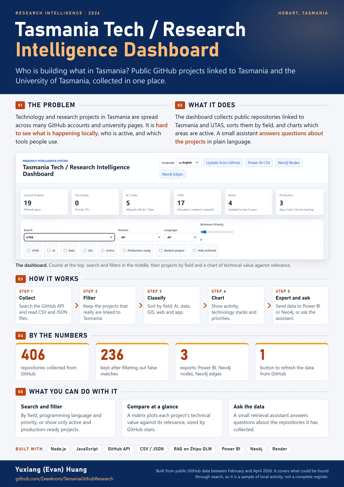

# Tasmania Tech / Research Intelligence Dashboard

Technology and research projects in Tasmania are spread across many GitHub accounts and university pages, so it is hard to see what is happening locally. This dashboard collects public GitHub repositories linked to Tasmania and the University of Tasmania in one place, sorts them by field, and shows which areas are active and which tools people use. A small assistant answers questions about the repositories.

## What it does

- Collects repositories through the GitHub API and keeps the ones that really are linked to Tasmania: 406 found by search, 236 kept.
- Classifies projects by field and charts activity and technology stacks.
- Offers search and filters, and a matrix of technical value against relevance.
- Exports the data for Power BI and Neo4j.
- Includes an optional retrieval assistant on the Zhipu GLM API.
- Works in English, Simplified Chinese and Traditional Chinese.

## What is in this repository

| Path | What it holds |
|---|---|
| `server.mjs` | The Node.js server: the dashboard's static files, the assistant endpoint and community contributions |
| `scripts/` | Scripts that build the dashboard data and check the result |
| `outputs/tasmania_research_dashboard/` | The dashboard itself and its data exports |
| `github_tasmania_repositories*.csv` | The collected repository lists |
| `DEPLOY.md` | How to run it locally or on Render |

## Run it

Node.js 20 or later. See [DEPLOY.md](DEPLOY.md) for the steps and the optional assistant key.

## Notes

Built from public GitHub data between February and April 2026. It covers what could be found through search, so it is a sample of local activity, not a complete register.
