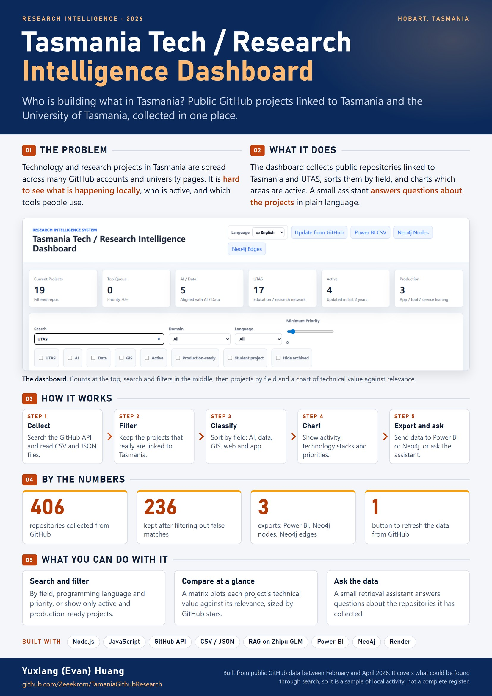
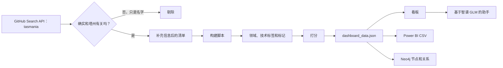
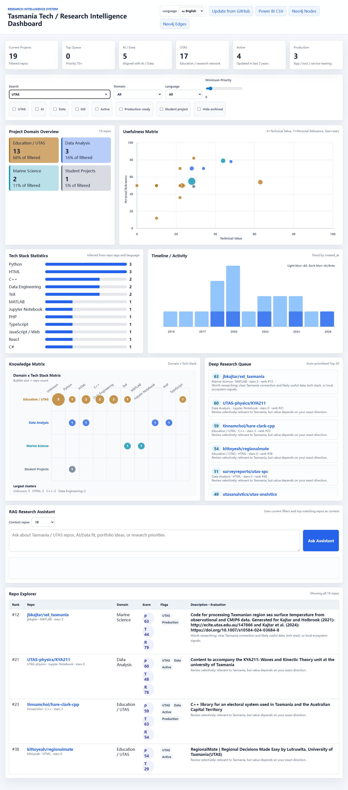

# Tasmania Tech / Research Intelligence Dashboard

[English](README.md) · **简体中文**

Tasmania Tech / Research Intelligence Dashboard（塔斯马尼亚科技与研究情报看板）把和塔斯马尼亚、塔斯马尼亚大学（UTAS）有关的公开 GitHub 仓库收集到一个地方。它按领域给仓库分类，用图表显示哪些方向活跃、大家用什么工具，还可以搜索、筛选和导出这份清单。它面向想看清本地在做什么的人：学生和求职者、想摸清本地技术与研究圈的人，以及想把数据放进自己工具里分析的人。

AI 是可选的，放在最后一步。一个基于智谱 GLM API 的小型检索助手，回答关于屏幕上这些仓库的问题。它只收到看板为这个问题挑出的记录，最多 30 条，并且被要求只根据这些记录对具体仓库下结论。密钥只留在服务器上；没有它，看板照样完整可用。

这是一个独立的作品集项目，数据来自一次 GitHub 搜索。它是公开活动的一个样本，不是塔州软件或研究的完整名录，也不是 UTAS 或塔州政府的官方资源。

这个仓库放的是源码：Node.js 服务器、看板页面、构建和检查脚本、收集到的仓库清单，以及给 Power BI 和 Neo4j 的导出文件。

<table>
<tr>
<td></td>
</tr>
<tr>
<td align="center"><a href="docs/poster.jpg">海报，2026 年 10 月</a></td>
</tr>
</table>

**线上看板：** [tamaniagithubresearch.onrender.com](https://tamaniagithubresearch.onrender.com/)
——和这个仓库是同一套服务器和数据，版本 0.2.0。它跑在 Render 的免费方案上，闲置时会休眠，所以第一次打开
可能要等一分钟左右才醒。

## 目录

- [一眼看懂](#一眼看懂)
- [要解决的问题](#要解决的问题)
- [给谁用](#给谁用)
- [一个仓库从头到尾](#一个仓库从头到尾)
- [界面](#界面)
- [已经做到的](#已经做到的)
- [设计原则](#设计原则)
- [公开数据与派生数据](#公开数据与派生数据)
- [怎么一步步做出来的](#怎么一步步做出来的)
- [出过的问题怎样变成规则](#出过的问题怎样变成规则)
- [技术栈](#技术栈)
- [接口](#接口)
- [验证](#验证)
- [怎么运行](#怎么运行)
- [还没做完的](#还没做完的)
- [这个项目说明了什么](#这个项目说明了什么)
- [版权与条款](#版权与条款)

## 一眼看懂

| | |
|---|---|
| 是什么 | 一个看板，收录和塔州、UTAS 有关的公开 GitHub 仓库，按领域分组，带图表、筛选、研究队列、导出和一个可选的问答助手 |
| 给谁用 | 关注本地技术和研究工作的学生和求职者、想弄清塔州谁在做什么的人，以及想在 Power BI 或 Neo4j 里用这份清单的分析人员 |
| 要解决的问题 | 本地项目分散在很多账号和页面里。在 GitHub 上搜 "tasmania"，结果里还混着只是借用这个名字的项目 |
| AI | 一个可选的检索助手，用智谱 GLM API（默认 `glm-4.7`）。它根据浏览器挑出的最多 30 条仓库记录回答问题，需要在服务器上设置密钥 |
| 技术栈 | 只用内置模块的 Node.js 20+、原生 HTML、CSS 和 JavaScript、GitHub REST API、智谱 GLM API、CSV 和 JSON、Power BI 和 Neo4j 导出、Render |
| 数据 | 2026 年 5 月 14 日从 GitHub Search API 得到 406 条结果；其中 236 条确认和塔州有关而保留；分为 11 个领域。只有公开元数据 |
| 证据 | 一次有记录的无头浏览器检查（2026 年 5 月 14 日）：6 张汇总卡片、236 行表格、236 个矩阵点、11 个领域块、20 张队列卡片，搜 "UTAS" 后剩 19 行，控制台没有报错 |
| 状态 | 版本 0.2.0。作品集项目，在 Render 免费方案上线。数据自 2026 年 5 月 14 日以后没有更新 |

## 要解决的问题

想了解本地技术和研究工作的人，得回答这样一些问题：

- 塔州有谁在写软件，做的是哪些领域？
- 哪些项目还在活跃，哪些已经归档或停更？
- 本地项目用什么语言和工具？
- 哪些项目来自 UTAS 的课程、研究团队或下属机构？
- 做 AI、数据或 GIS 方向的话，哪些项目最值得先看？
- 这份清单能不能拿到别的工具里继续分析？

GitHub 不能直接回答这些问题。搜 "tasmania" 得到 406 个仓库，其中很多只是把这个词当名字用。看板保留了确实和塔州有关的 236 个，并把它们整理好，让这些问题在一个页面上就能回答。

## 给谁用

| 角色 | 他们需要回答的问题 | 看板给他们看什么 |
|---|---|---|
| 学生或求职者 | 哪些本地项目和 AI、数据或 GIS 工作对得上，哪些最值得先看？ | 按领域和标记筛选、优先级分数、前 20 名的研究队列，以及助手 |
| 想摸清本地圈子的人 | 谁在活跃，在哪些领域，用什么工具？ | 领域块、按创建年份的时间线、技术栈统计，以及领域与技术的交叉矩阵 |
| 分析人员 | 能不能在自己的工具里用这些数据？ | 一份 Power BI CSV，以及 Neo4j 的节点和关系文件 |
| 本地开发者 | 我的项目没被收进去，能补上吗？ | 一个贡献表单，先检查有没有塔州或 UTAS 的信号，再添加项目或个人主页 |

这些是看板设计时想到的用途。没有做过用户调研。

## 一个仓库从头到尾

1. **搜索。** 用 GitHub Search API 搜 "tasmania"。2026 年 5 月 14 日返回 406 个仓库，保存了名称、链接、描述、语言、星标数、复刻数、是否归档、日期和主题标签。
2. **筛选。** 只有名称或描述明确指向塔州的地点、政府机构或服务、UTAS、塔州物种或生态、本地商家或社区、历史、旅游、地图、气候、交通、房地产或数据的仓库才保留。只是用了这个词的通用库、个人主页和演示项目被剔除。保留 236 个。
3. **补充信息。** 每个保留的仓库都加上一段简短的中文描述、八个原始分类之一、一句简短评价，以及一个相关性等级，附 1 到 5 的分数和理由。
4. **分类。** `scripts/build_research_dashboard.mjs` 用关键词规则把每个仓库归入 11 个领域之一，规则按固定顺序检查，第一个是 AI / Machine Learning，最后一个是 Other Tasmania。先命中的规则说了算。它还推断最多八个技术标签，并设置八个标记：UTAS、AI、数据、GIS、活跃、已归档、学生项目和偏生产可用。
5. **打分。** 技术价值看星标数和复刻数（取对数）、最近的活跃程度、生产可用的信号，以及是不是 AI、数据或 GIS 方向。个人相关度从补充信息里的分数起算，再给这个项目关注的方向加权。优先级把两者合起来，相关度的权重稍高。活跃程度以固定日期 2026 年 5 月 14 日为准，所以重新构建得到的分数不变。
6. **导出。** 脚本写出 `dashboard_data.json`、一份 236 行的 Power BI CSV，以及按优先级排前 140 个仓库的 Neo4j 节点和关系文件。
7. **浏览。** 看板显示汇总数字、领域块、技术价值对相关度的矩阵（点的大小按星标数）、技术栈条形图、时间线、领域与技术的交叉矩阵、研究队列和表格。搜索和筛选会同时更新所有面板。
8. **提问。** 助手按关键词匹配加优先级，给当前筛选出的仓库排序，把前 5 到 50 个（默认 10 个）发给服务器。服务器最多把 30 个交给模型，并要求它只根据这些记录对仓库下结论。

## 界面

完整的看板页面，由检查脚本在 2026 年 5 月 14 日搜 "UTAS" 之后截下（236 个仓库里的 19 个）。从上到下：汇总卡片、搜索和筛选、领域块、技术价值对相关度的矩阵、技术栈、时间线、领域与技术的交叉矩阵、研究队列、助手和仓库表格。贡献表单和项目说明是 5 月 17 日加的，不在这张截图里。

## 已经做到的

| 能力 | 已实现的内容 |
|---|---|
| 仓库清单 | 236 个和塔州有关的公开仓库，从 406 条搜索结果里留下 |
| 领域 | 按有顺序的关键词规则分成 11 个领域，以色块显示数量和占比 |
| 汇总数字 | 六张卡片，随当前视图变化。全量清单是：236 个仓库，6 个优先级在 70 以上，72 个属于 AI 或数据，31 个和 UTAS 有关，116 个在近两年内活跃，60 个偏生产可用 |
| 搜索和筛选 | 文字搜索、领域、语言、最低优先级，以及八个勾选项：UTAS、AI、Data、GIS、Active、Production-ready、Student project 和 Hide archived |
| 图表 | 技术价值对相关度的矩阵（点的大小按星标数）、最常见的 16 个技术标签、按创建年份统计的仓库数（2011 到 2026 年），以及领域与技术的交叉矩阵 |
| 研究队列 | 按优先级排前 20 的仓库，每个都附领域、语言、星标数和一句阅读建议 |
| 仓库表格 | 排名、领域、三个分数、标记、描述和评价 |
| 实时更新 | "Update from GitHub" 按钮在浏览器里重新搜一次 "tasmania"（最多 10 页、每页 100 条），保留通过纳入和排除规则的结果，再合并进来。结果只存在这个浏览器里 |
| 社区贡献 | 添加一个 GitHub 项目或个人主页。先检查有没有 UTAS、塔州、塔州地名或课程代码的信号，然后存进浏览器和服务器 |
| 助手 | 可选。用智谱 GLM，根据收到的记录，用所选的语言回答 |
| 界面语言 | 英文、简体中文和繁体中文。浏览器会记住选择 |
| 导出 | Power BI CSV（236 行、24 列）、Neo4j 节点（346 个）和关系（587 条），以及一份补充信息后清单的 Excel 工作簿 |
| 部署 | 本地和 Render 用同一个 Node.js 服务器、一个版本接口，以及一个能启动和停止本地服务器的 Windows 启动器 |

## 设计原则

- **只留能和塔州对上的。** 只是把这个词当名字用的仓库会被剔除，不管它有多热门。
- **规则看得懂。** 领域、技术标签和标记都来自同一个脚本里的关键词规则，按固定顺序检查，每个归类都能追溯。
- **个人相关度就标成个人的。** 相关度分数给 AI、数据、GIS 和 UTAS 加权，因为这些是这个项目关注的方向。它和技术价值并排显示，而不是藏在一个总分里。
- **固定参照日期。** 活跃程度以 2026 年 5 月 14 日为准，所以重新构建数据，分数不变。
- **助手只根据收到的记录回答。** 浏览器挑记录，服务器最多放 30 条，指令禁止超出这些记录对仓库下结论。
- **密钥只留在服务器上。** 浏览器拿不到它，`.env` 被 git 忽略。
- **贡献要检查，不直接信。** 贡献必须是 GitHub 链接，并且有塔州或 UTAS 的信号。添加一个人只会加他的个人主页，不会把他的全部仓库都收进来。
- **数据可以带出看板。** Power BI 和 Neo4j 文件让别人能在自己的工具里分析这份清单。

## 公开数据与派生数据

| 数据集 | 是什么 | 数据类别 |
|---|---|---|
| `github_tasmania_repositories.csv` 和 `.md` | 2026 年 5 月 14 日在 GitHub 搜 "tasmania" 得到的 406 条结果：名称、链接、描述、语言、星标数、复刻数、是否归档、日期和主题标签 | 公开的 GitHub 元数据 |
| `github_tasmania_repositories_true_only.csv` 和 `.md` | 相关性筛选后保留的 236 个仓库。`.md` 文件写明了筛选规则 | 公开的 GitHub 元数据，已筛选 |
| `github_tasmania_repositories_true_only_enriched.csv` | 同样这 236 个，加上中文描述、原始分类（8 个）、评价、相关性等级（高 85、中 77、低 74）、分数和理由 | 派生 |
| `outputs/tasmania_research_dashboard/data/dashboard_data.json` | 领域、技术标签、标记、分数、汇总数字、时间线和关系图 | 派生 |
| Power BI、Neo4j 和 Excel 文件 | 派生数据的导出 | 派生 |
| `outputs/tasmania_research_dashboard/data/community_contributions.json` | 通过贡献表单加进来的项目和个人主页 | 访客提交的公开 GitHub 元数据 |

全量清单的领域分布：Web / App 65、Data Analysis 53、GIS / Geography 33、Other Tasmania 21、Education / UTAS 13、Local Business / Tourism 11、AI / Machine Learning 10、Marine Science 9、Government / Public Data 8、Student Projects 7、Research Projects 6。

这些局限是实打实的。清单只覆盖一个搜索词，从没写过 "tasmania" 的项目会漏掉，除非有人来贡献。领域、标记和分数来自对名称和简短描述的关键词规则，所以仓库可能被分错领域。语言用的是 GitHub 标注的主要语言，有 55 个仓库没有记录语言。快照日期之后，星标数和活跃程度都会变。清单里的仓库属于它们的所有者；这个仓库只保存它们的公开元数据和链接。

## 怎么一步步做出来的

| 日期 | 加了什么 |
|---|---|
| 2026 年 5 月 14 日 | GitHub 搜索（406 条结果）和相关性筛选（保留 236 个）；补充信息后的清单；带领域、技术标签、标记和打分的构建脚本；有搜索、筛选、图表、研究队列和助手的三语看板；Power BI、Neo4j 和 Excel 导出；无头浏览器检查 |
| 2026 年 5 月 14 日 | 可以选助手收到多少条记录、Windows 启动器，以及版本接口和版本标记（0.2.0） |
| 2026 年 5 月 17 日 | 带自动信号检查的社区贡献，存在浏览器和服务器上；页面内的项目说明；Render 部署说明 |
| 2026 年 5 月 17 日 | 启动器可以记住助手密钥，按当前 Windows 用户加密保存 |
| 2026 年 10 月 11 日 | 一份 README 和一页海报 |

海报页脚写的制作时间是 2026 年 2 月到 4 月。这个仓库里的文件记录的是之后的一轮：搜索、筛选和提交都在 2026 年 5 月 14 日，打分也以这一天为准。

## 出过的问题怎样变成规则

| 问题 | 规则 |
|---|---|
| 搜 "tasmania" 得到 406 个仓库，其中很多只是把这个词当名字用：一个叫 TASMANIAN 的数值计算工具包、它的 Julia 封装，以及叫 TasmanianTraders 的 Azure 示例 | 只有名称或描述指向塔州相关内容的仓库才保留，剔除了 170 个。浏览器里的实时更新也用同类的纳入和排除清单 |
| 贡献一个人，可能会把他的全部仓库都带进来，而大多数和塔州无关 | 添加一个人只加他的个人主页；添加一个项目只加这一个仓库 |
| 贡献可能是任何 GitHub 链接 | 它的 GitHub 元数据、README 或填写的证据里，必须有 UTAS、塔州、塔州地名或 UTAS 式课程代码的信号 |
| 助手需要一个私人的 API 密钥 | 密钥只在服务器上读取，从不发给浏览器。`.env` 被 git 忽略，启动器按 Windows 用户加密保存密钥 |

## 技术栈

- Node.js 20+，只用内置模块（`http`、`fs`、`path`）；没有 npm 依赖
- 原生 HTML、CSS 和 JavaScript 模块；图表由看板自己的代码用 SVG 和 canvas 画出
- GitHub REST API，用于搜索，以及查询仓库、个人主页和 README
- 智谱 GLM API（默认 `glm-4.7`），用于可选的助手
- CSV 和 JSON 数据文件，以及一份 Excel 工作簿
- Power BI（导入 CSV）和 Neo4j（节点和关系 CSV）
- Playwright 加无头 Chrome，用于检查脚本
- Render（`render.yaml`，免费方案）和一个 Windows PowerShell 启动器

部署和贡献存储的说明见 [DEPLOY.md](DEPLOY.md)（英文为主，附简体和繁体中文）。

## 接口

| 方法和路径 | 用途 |
|---|---|
| `GET /` 和静态文件 | 看板页面、脚本、样式和数据 |
| `GET /api/version` | 应用名称、版本、模型名称，以及运行在本地还是 Render 上 |
| `POST /api/chat` | 发送问题、回答语言和选中的记录，返回模型的回答。没有设置密钥时返回错误 |
| `GET /api/contributions` | 列出已保存的社区贡献 |
| `POST /api/contributions` | 做完格式检查（类型、GitHub 链接和证据）后保存一条贡献 |

## 验证

- `scripts/verify_dashboard.mjs` 用无头 Chrome 打开本地看板，数汇总卡片、表格行、队列卡片、矩阵点和领域块，量关系图的宽度，搜 "UTAS"，保存整页截图，并记录控制台消息。设置 `RUN_GITHUB_UPDATE=1` 时，它还会点更新按钮并记录结果。
- 记录下来的结果是 2026 年 5 月 14 日的 [`verification.json`](outputs/tasmania_research_dashboard/verification.json)：6 张汇总卡片、236 行、20 张队列卡片、236 个矩阵点、11 个领域块，搜 "UTAS" 后剩 19 行，没有控制台消息。GitHub 更新那一步没有运行。
- `scripts/verify_languages.mjs` 在英文、简体中文和繁体中文之间切换页面，读取页面语言、标题、标签、第一条描述和行数。它只打印结果，不保存，所以这里没有留下它的结果。

没有单元测试。记录下来的检查早于 5 月 17 日加的功能，而且两个脚本都指向构建机器上的路径，换一台机器要先改路径才能运行。

## 怎么运行

需要 Node.js 20 或更高版本。运行 `npm install`，再运行 `npm start`，然后打开 `http://127.0.0.1:8787/`。本地运行、Windows 启动器（`LaunchDashboard.bat`）和 Render（`render.yaml`）的完整步骤见 [DEPLOY.md](DEPLOY.md)。

助手是可选的。它需要在服务器上把 `ZHIPU_API_KEY`（可选再加 `ZHIPU_MODEL`）设为环境变量；[`.env.example`](.env.example) 列出了这些变量。服务器读的是环境变量，自己不会加载 `.env` 文件。`.env` 被 git 忽略。永远不要提交真实的密钥，也不要把它放进看板的文件里。

## 还没做完的

- 搜索、筛选和补充信息这几步（从 406 到 236、中文描述和相关性等级）是在这个仓库之外做的。这里只有它们的产出，所以没法从这个仓库重跑。
- 构建和检查脚本里写着构建机器上的文件夹路径。生成工作簿的脚本还需要一个没写进 `package.json` 的表格库。
- 贡献是自动检查的，没有人工审核。在 Render 免费方案上，保存的文件可能在重新部署或重启时丢失；DEPLOY.md 建议接持久磁盘或数据库。
- 实时更新调用 GitHub 时不带令牌，所以可能碰到 GitHub 对匿名请求的限制，而且结果只留在一个浏览器里。
- 助手只看得到元数据和简短描述，看不到代码或 README，它的回答也没有经过核对。
- 数据自 2026 年 5 月 14 日以后没有更新。

## 这个项目说明了什么

- 关键词搜索只是起点，不是清单：406 条结果里有 170 条只是借用了这个名字。
- 本地的大部分工作规模小、不显眼：保留的 236 个仓库里，199 个没有星标，216 个没有复刻，只按星标排序会把大部分都藏起来。
- 一个项目可能同时符合好几个领域，所以规则的顺序决定了结果。把顺序写清楚，每个归类就都说得清。
- 把技术价值和个人相关度并排显示，项目自己的偏好就看得见，而不是藏在一个总分里。
- 只把屏幕上的记录交给助手，能让回答紧扣清单，但回答也不会比那些简短描述更好。

## 版权与条款

© 2026 Tasmania Tech / Research Intelligence Dashboard。保留所有权利，见 [LICENSE](LICENSE)。本仓库里的文字、海报、截图和
文档，以及项目自己的代码和设计，未经书面许可不得转载、复制或改编。欢迎分享链接。数据文件里列出的仓库属于它们的所有者，
各自保留自己的许可；这个仓库只保存它们的公开元数据和链接。
